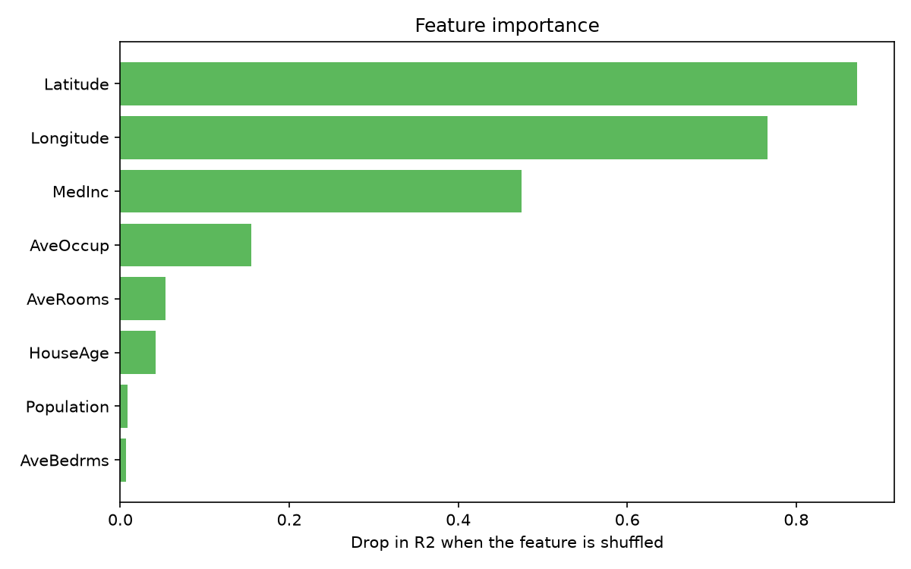
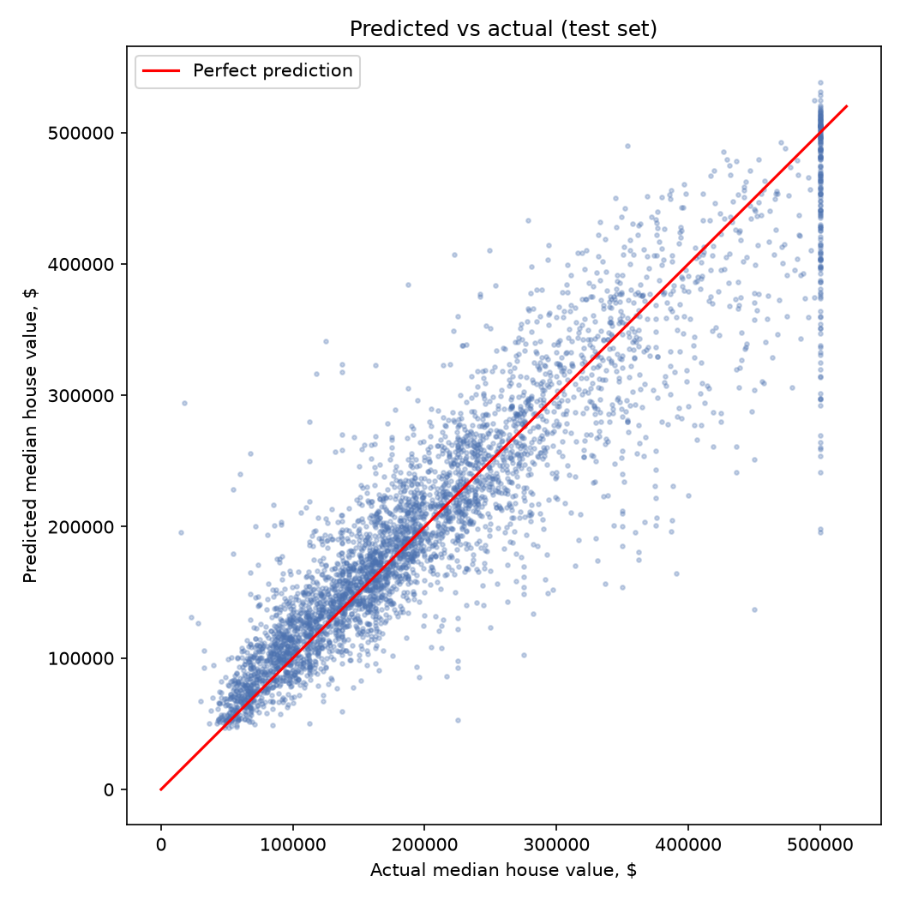

# California Housing Price Prediction

**Live demo:** https://california-housing-k5.streamlit.app/

Predicting the median house value of California districts from census data, using scikit-learn. Includes data exploration, baseline models, gradient boosting, error analysis, feature importance and an interactive Streamlit dashboard.

Note: the target is the median house value of a district (1990 census), not the price of an individual house or apartment.

## Results

Test set: 4,128 districts (20% of the data), identical split for every model.

| Model | MAE | RMSE | R2 |
|---|---|---|---|
| Always the mean (baseline) | $90,607 | $114,486 | 0.000 |
| Linear regression | $53,320 | $74,558 | 0.576 |
| Random Forest | $32,679 | $50,429 | 0.806 |
| Gradient Boosting | $30,154 | $45,407 | 0.843 |

The best model predicts the district value within $50,000 of the truth for 82.7% of test districts.

## Feature importance

Permutation importance on the test set: Latitude (0.872), Longitude (0.766), MedInc (0.475), AveOccup (0.155), AveRooms (0.053), HouseAge (0.042), Population (0.009), AveBedrms (0.007). Location matters more than income.





## Dashboard

Three tabs: predict a price with sliders, model quality metrics and a map of the largest errors.

```bash
streamlit run app.py
```

## Installation

```bash
git clone https://github.com/om-mmdv/california-housing.git
cd california-housing
python -m venv venv
venv\\Scripts\\activate
pip install -r requirements.txt
```

Then run: python -m src.explore, baseline, train, evaluate, export.

## Limitations

- House values above $500,000 are capped at 5.0 in the data (about 5% of districts), so the model cannot learn real prices above that level.
- The data is from the 1990 census, so it does not reflect today's market.
- Targets are district medians, not individual properties.
- No hyperparameter tuning was done.

## Possible improvements

- Tune hyperparameters with cross-validation
- Add features such as distance to the coast or big cities
- Try XGBoost or LightGBM
